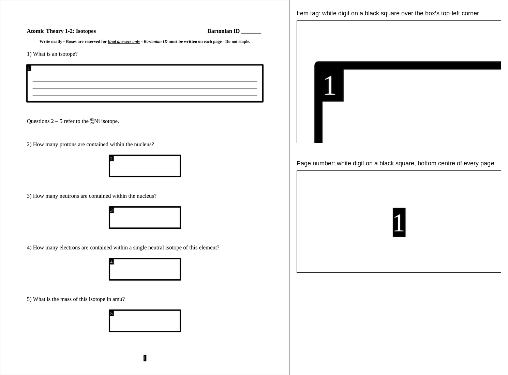

# Assignment Format

The software only scores documents laid out in this format. It finds what to score by reading printed marks on the page, so a document that departs from the format is processed wrongly or not at all, usually without an error. Blank examples are in [samples/](../samples/); copying one is the easiest way to get it right.

## The rules

1. **Letter paper, portrait, 1-inch margins, Liberation Serif** (Times New Roman is equivalent). Print at 100 % scale; scan at 300 dpi.
2. **Title at top left and the ID line at top right, bold, on every page, in the same place every time.** The students hand-write their three-digit pseudonym on the ID line on every page. The label ("Bartonian ID" in the samples) is whatever pseudonym scheme is set in APPLIANCE SETTINGS; the title must be identical on every page.
3. **Page number at bottom centre: a white digit on a solid black box, regular weight, at the same spot on every page.** Numbers run 1, 2, 3 … within the assignment. The software reads this box with local OCR, so no printed line or text may come near it — keep box borders about half an inch above it. Students writing over it is tolerated; a printed border crossing it is not.
4. **Every answer goes in a box: a closed rectangle with a heavy black border, with the item number printed in white on a black tag over its top-left corner.** The box crops are sent to the AI without their positions; the tag is how it knows which item is which. Tags are unique within the assignment; sub-parts are lettered (`11a`, `11b`).
5. **Nothing else on the page may be a rectangle.** Any other closed box at least a quarter inch tall — a table, a framed figure, a bordered text block — is detected as an answer box and sent for scoring. Figures go unframed; tables are drawn as open rules.
6. **A box inside a box is part of the outer box.** Lines for a written response, a grid for a graph, or a small "Final Answer" cell may be drawn inside a box; a second scored item may not.
7. **Boxes of the same kind are the same size throughout, sized for the answer and no larger.** Provider charges scale with the area sent. Centre the boxes or keep them on a consistent column grid, clear of the margins and of each other.
8. **Do not staple.** Every page carries its own ID and page number, so pages are scanned as a loose stack in any order.

The blank master PDF placed in `01 Master Assignments` must be the exact file the students' copies were printed from; it is sent with every batch.

Before using a new document, look at it the way the software will: rasterize a page at 300 dpi and check that each tag touches its box, the page-number box has nothing printed near it, and the only rectangles on the page are the answer boxes.
